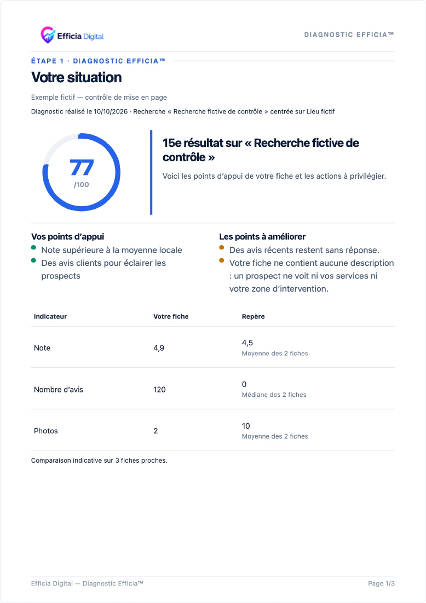

# Diagnostic gratuit — contrat client V5

Trois pages : situation, lecture du score et priorités, choix de la suite. Le calcul du score est inchangé. Les preuves complètes restent internes ; le client lit des constats sourcés sans détails techniques. Une confirmation visuelle du rang, datée et rattachée à la recherche, conditionne le badge de profil. Les contrôles inconnus ne sont pas transformés en défauts.

La page commerciale utilise les destinations d’achat existantes et un lien WhatsApp issu de `CONFIG.contact.whatsapp`. Le message prépare le nom de l’entreprise sans envoi. Le bloc Pack dit : « Nous préparons les optimisations, puis nous vous les soumettons pour validation avant toute publication. » Le délai Audit reste celui du contenu validé (5 jours ouvrables) ; cette livraison n’introduit pas de nouveau réglage métier.

## Validation et limites

La suite ciblée V5 a validé 108 tests. La suite **complète** est exécutée séparément pour cette PR ; elle ne doit pas être confondue avec ce sous-ensemble. La base `main` / `0a3b5fe` présente elle-même des échecs. Le bilan détaillé avant commit est joint ci-dessous après exécution.

Les neuf échecs serveur demandés sont isolés pour une seconde PR. Les fichiers `freeDiagnosticAdminSecurity.test.js` et `freeDiagnosticDuplicateAuthorization.test.js` et leur route de collecte restent inchangés dans la PR du rendu.

## Captures publiques

Les images suivantes proviennent exclusivement d’un modèle fictif, sans snapshot ou coordonnées de prospect. Elles illustrent la composition, pas un diagnostic réel. Génération locale : `node scripts/render-diagnostic-evidence-controls.mjs --pr-preview`, puis conversion du PDF de contrôle en PNG.

## Confidentialité et publication

`output/`, `.dev.vars*`, `.env*`, `.wrangler/`, `.wrangler-state/`, fichiers SQLite et verrous temporaires `.~*` sont exclus de Git. Les exports et JSON réels restent uniquement locaux. Les snapshots synthétiques de tests et les captures fictives sont les seuls éléments de démonstration publiables. Une recherche sur le diff indexé contrôle les signatures de secrets, les adresses e-mail hors domaines de test et les coordonnées présentes dans les fichiers locaux de collecte, sans les afficher.

Tous les commits de cette préparation portent `[CF-Pages-Skip]` pour éviter le déploiement automatique Pages. Aucun déploiement manuel ni fusion n’est demandé.

## Suite complète avant commit

Commande : `node --test --test-concurrency=1 tests/*.test.js`.

- Branche rendu : 1 403 tests, 1 356 réussis, **27 échecs**, 20 déjà conditionnels/non exécutés dans la suite existante. Aucun nouveau `skip`.
- Base indépendante `0a3b5fe` : 1 329 tests, 1 289 réussis, **20 échecs**, 20 conditionnels/non exécutés.
- Les assertions de nombre de pages ont été adaptées de quatre à trois. Les autres échecs restent visibles ; cette PR en brouillon **ne satisfait pas encore une porte de fusion verte**. Des attentes de l’ancien rendu et des scénarios techniques restent à réconcilier sans affaiblir leurs assertions.

Échecs observés sur la branche rendu :

- `tests/analyzeCategoryMapping.test.js:219:1` — analyze : la fiche analysée n'apparaît jamais dans ses propres concurrents enregistrés
- `tests/cgvPurchaseFlow.test.js:313:1` — la migration CGV historique reste inchangée et la migration suivante est additive
- `tests/competitorRestorationWorkflow.test.js:11:1` — real save → destroy document → admin list → reopen restores every competitor field
- `tests/competitorRestorationWorkflow.test.js:47:1` — Selbelec real snapshot → standard reopen → PDF button, without data injection
- `tests/diagnosticJourneyBrowser.test.js:15:1` — Chrome : capture, rechargement, même parcours et examen fiche trouvée
- `tests/diagnosticJourneyBrowser.test.js:15:1` — Chrome : capture, rechargement, même parcours et examen not_found
- `tests/diagnosticJourneyBrowser.test.js:15:1` — Chrome : capture, rechargement, même parcours et examen unavailable
- `tests/diagnosticJourneyBrowser.test.js:15:1` — Chrome : capture, rechargement, même parcours et examen ambiguous
- `tests/diagnosticJourneyBrowser.test.js:15:1` — Chrome : capture, rechargement, même parcours et examen declared_absent
- `tests/freeDiagnosticAdminSecurity.test.js:270:1` — la collecte serveur réutilise le même analysisId sans créer de commande ni inventer l’activité
- `tests/freeDiagnosticAdminSecurity.test.js:390:1` — la relance réelle Bivert Alain classe Fournisseur d’électricité comme inadaptée et conserve atomiquement le reste
- `tests/freeDiagnosticAdminSecurity.test.js:493:1` — un échec de relance conserve intégralement les anciens résultats et le brouillon
- `tests/freeDiagnosticAdminSecurity.test.js:543:1` — une fiche introuvable reste awaiting_review, efface les sentinelles et ne crée aucune donnée métier annexe
- `tests/freeDiagnosticDuplicateAuthorization.test.js:212:1` — 1. un brouillon gratuit admin_manual peut relancer sa recherche
- `tests/freeDiagnosticDuplicateAuthorization.test.js:228:1` — 2. un brouillon gratuit duplicate_manual peut désormais relancer sa recherche
- `tests/freeDiagnosticDuplicateAuthorization.test.js:279:1` — 6. une analyse liée à une vraie demande historique reste acceptée sans métadonnée manuelle
- `tests/freeDiagnosticDuplicateAuthorization.test.js:294:1` — 7. une relance de recherche reste possible après un premier PDF
- `tests/freeDiagnosticDuplicateAuthorization.test.js:332:1` — 9. un échec fournisseur sur un brouillon duplicate_manual ne modifie rien partiellement
- `tests/freeDiagnosticReviewVolume.test.js:282:1` — smoke UI/PDF : un panel électrique insuffisant ne rend ni benchmark ni concurrent hors profil
- `tests/reportNarrativeOverrides.test.js:148:1` — Chrome : compteurs réconciliés, présence Google et catégories secondaires dans le PDF quatre pages
- `tests/reportNarrativeOverrides.test.js:513:1` — Chrome V3.2 : le rapport réel restitue les valeurs, couleurs et barres photos et les panels insuffisants
- `tests/reportNarrativeOverrides.test.js:688:1` — Gabbana historique : le HTML réellement composé pour telechargerPDF recalcule la synthèse automatique et préserve une personnalisation
- `tests/reportNarrativeOverrides.test.js:839:1` — V3.2 adapte les pages 4 et 5 au nombre réel de priorités et conserve le titre personnalisé de revendiquee
- `tests/reportNarrativeOverrides.test.js:918:1` — PDF Chrome réel : les compteurs prioritaires des pages 3 et 5 et le libellé Description restent identiques
- `tests/reportNarrativeOverrides.test.js:992:1` — éditeur V3.2 : le titre page 1, une priorité et le teasing sont persistés, restaurés et capturés par html2canvas/jsPDF
- `tests/reportNarrativeOverrides.test.js:1115:1` — activité, prénom et textes sauvegardés : aperçu et PDF attendent le brouillon puis rendent quatre pages
- `tests/reportNarrativeOverrides.test.js:1418:1` — smoke Chrome : le détail DNS brut persiste dans le brouillon interne et le rapport ne rend que la formulation sûre
